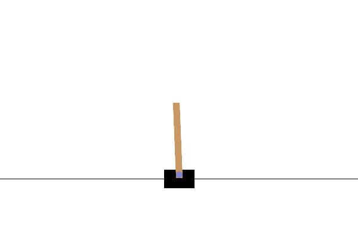

# EasyRLlib

EasyRLlib is a compact PyTorch reinforcement-learning library with a
reproducible `uv` environment. It includes DQN, Dueling DQN, PPO, SAC, DDPG,
TD3, and A2C implementations for Gymnasium environments.

## Demos

**Dueling DQN — CartPole-v1**



**PPO — BipedalWalker-v3**


## Setup

EasyRLlib supports Python 3.10--3.12. Install [uv](https://docs.astral.sh/uv/)
and create the locked development environment:

```bash
uv sync --all-groups
```

Gymnasium is installed with its full optional dependency set, including
Classic Control, Box2D, Atari, and MuJoCo. Linux users also need a system MPI
implementation (for example, `libopenmpi-dev` on Ubuntu/Debian).

Run the test suite:

```bash
uv run pytest
```

## Train

Experiments are configured with YAML files. For example, train Dueling DQN on
CartPole with CUDA when an NVIDIA GPU is available:

```bash
uv run python run.py -n 1 -c experiment/dueling_dqn_cartpole/run_config.yaml
```

Set `device: "cpu"` in a run configuration to train without CUDA. Training
logs and checkpoints are written below `output/`.

## Visualize and evaluate

Create reward curves for every run below `output/`:

```bash
uv run python script/visualize_results.py curves
```

Evaluate and render the included Dueling DQN or PPO BipedalWalker checkpoints:

```bash
uv run python script/visualize_results.py evaluate
uv run python script/visualize_results.py evaluate-ppo
```

Generated plots, GIFs, and evaluation metrics are written to `vis/`, which is
intentionally Git-ignored. The two GIFs shown above are tracked copies in
`assets/demos/` for this README.

## Algorithms

| Algorithm | Discrete actions | Continuous actions |
| --- | :---: | :---: |
| DQN | Yes | No |
| Dueling DQN | Yes | No |
| SAC | Yes | Yes |
| PPO | Yes | Yes |
| DDPG | No | Yes |
| TD3 | No | Yes |
| A2C | Yes | Yes |

## References

- [OpenAI Spinning Up](https://github.com/openai/spinningup)
- [ElegantRL](https://github.com/AI4Finance-Foundation/ElegantRL)
